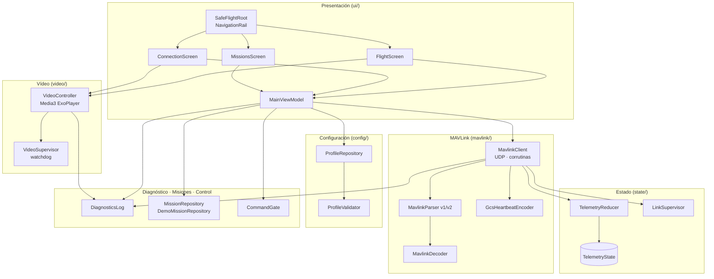
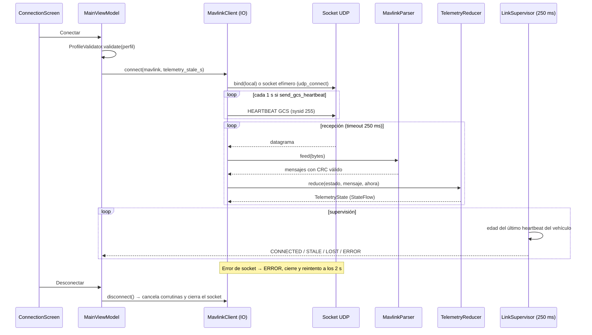
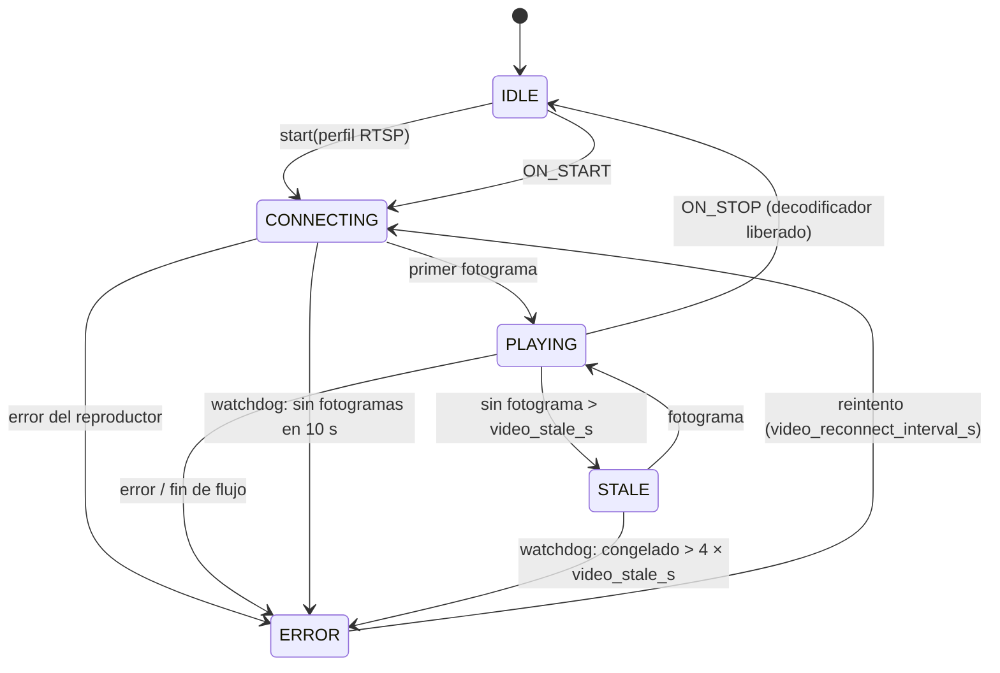

# Arquitectura de SafeFlight Android

> Migrada a Java + XML (ADR-0010). Las secciones siguientes describen los mismos componentes;
> la correspondencia de archivos y nombres está en [android-java.md](../development/android-java.md).

## 1. Resumen

| Aspecto | Decisión | Justificación |
|---|---|---|
| Lenguaje / UI | Java 17 + Android Views (XML, ViewBinding, Material 3) | [ADR-0010](../adr/ADR-0010-android-java-views.md) (sustituye a ADR-0002); guía: [android-java.md](../development/android-java.md) |
| Patrón | MVVM: `MainViewModel` + `LiveData`; contenedor manual de dependencias (`AppContainer`) | Sin framework DI para un MVP de un módulo |
| Módulos Gradle | Uno (`:app`), separación por paquetes | Varios módulos no aportan beneficio aún |
| MAVLink | Analizador propio (subconjunto de telemetría) | [ADR-0004](../adr/ADR-0004-mavlink-telemetry.md) |
| Vídeo | Media3 ExoPlayer + `media3-exoplayer-rtsp` | RTSP/H.264 con baja latencia, mantenido por Google |
| Persistencia | `SharedPreferences` con JSON (`org.json`, `ProfileJson`) | Mismo esquema que Desktop |
| SDK | `minSdk 26`, `targetSdk 35`, `compileSdk 36` | MK32 usa Android 9 (API 28) |
| Orientación | Horizontal (`sensorLandscape`) | Pantalla del MK32 |
| Build | AGP 8.13.2, Gradle 8.14, JDK ≥ 17 | [ADR-0007](../adr/ADR-0007-build-strategy.md) |

## 2. Componentes

| Paquete | Responsabilidad | Dependencia de Android |
|---|---|---|
| `mavlink` | Analizador, decodificador, cliente UDP, heartbeat de GCS | Ninguna (JVM puro) |
| `state` | Reductor de telemetría y supervisor del enlace (funciones puras) | Ninguna |
| `config` | Modelo de perfiles, validación, repositorio | Solo `KeyValueStore` (interfaz) |
| `video` | `VideoController` (Media3) y `VideoSupervisor` (puro) | Media3 |
| `diagnostics` | Registro circular de eventos, réplica en logcat | `android.util.Log` (opcional) |
| `mission` | Modelo e interfaz de misiones; datos de demostración | Ninguna |
| `control` | `CommandGate`: decisión única sobre comandos futuros | Ninguna |
| `ui` | Pantallas Compose y `ViewModel` | Compose |

La lógica crítica (analizador, reductor, supervisores, validación, puerta de comandos)
no depende de Android y se prueba en la JVM con JUnit.

## 3. Recepción MAVLink

Transportes: `udp_listen` (el router MAVLink envía a este dispositivo) y `udp_connect`
(este dispositivo envía heartbeats de GCS a un servidor remoto, que responde a su
dirección). `udp_connect` exige `send_gcs_heartbeat = true`; la interfaz advierte de que,
con `FS_GCS_ENABLE` activo en ArduPilot, dejar de enviarlos puede activar el failsafe de GCS.

## 4. Reproducción y recuperación de vídeo

* Búferes reducidos (`300–1500 ms`) para priorizar latencia.
* La edad del último fotograma procede de `VideoFrameMetadataListener`.
* El *watchdog* cubre fallos que no generan error en el reproductor (verificado: un
  proxy TCP que acepta la conexión con el servidor RTSP caído).
* Sin superficie visible (pantalla de misiones) no se evalúa congelación.
* Los eventos de reproductores sustituidos se ignoran para evitar reaperturas dobles.

## 5. Ciclo de vida

| Evento | Telemetría | Vídeo |
|---|---|---|
| `onCreate` | El contenedor de aplicación mantiene el cliente | Se crea `VideoController` |
| `onStart` | — | Se abre la fuente del perfil activo |
| `onStop` | Continúa (ámbito de aplicación) | Se libera el decodificador |
| Cierre del proceso | El sistema libera el socket | — |
| Desconectar | Cancela corrutinas y cierra el socket | — |

La pantalla permanece encendida (`FLAG_KEEP_SCREEN_ON`).

## 6. Pantallas

* **Vuelo:** vídeo principal; indicadores de enlace MAVLink y vídeo; armado y modo
  (atenuados como «último» si la telemetría no está vigente); altitudes, velocidades,
  rumbo, batería, GPS, posición; mensajes del autopiloto por severidad; banner de
  telemetría obsoleta o perdida; controles bloqueados.
* **Conexión:** selección y edición de perfiles; diagnóstico separado de telemetría
  (endpoint, edad de heartbeat, datagramas, tramas válidas/descartadas, heartbeats GCS,
  reintentos) y de vídeo (URL, resolución, edad, fotogramas, reintentos, vista previa);
  registro de eventos.
* **Misiones:** agrupadas por estado, con ejecución simulada/física diferenciada y un
  banner que identifica los datos como demostración.

## 7. Controles de vuelo

Ver [ADR-0008](../adr/ADR-0008-flight-commands-disabled.md). `CommandGate.PHYSICAL_COMMANDS_ENABLED = false`
es una constante de compilación; el módulo MAVLink no contiene codificador de comandos.
Los botones permanecen visibles y explican el motivo del bloqueo.

## 8. Limitaciones

* Validado en emulador (API 36, x86_64); **no** en el SIYI MK32 (PENDIENTE DE HARDWARE).
* Vídeo solo RTSP; un flujo RTP/UDP sin RTSP (modo actual de Desktop por 5G) no es
  reproducible en Android sin publicar un servidor RTSP.
* La integración de misiones usa datos de demostración.
* Un único vehículo por conexión.
