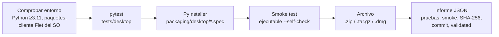
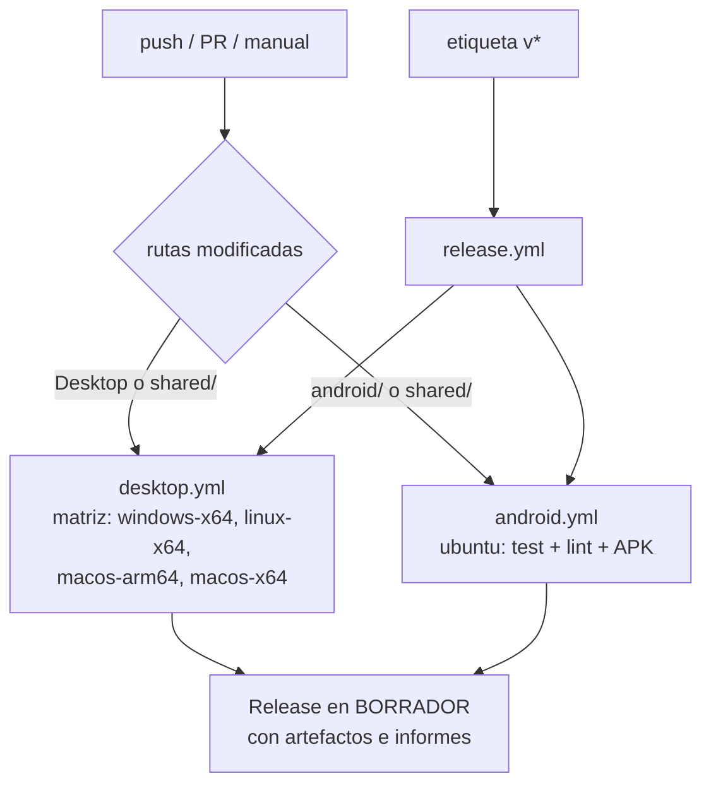

# Arquitectura de compilación y despliegue

## 1. Punto único de entrada

```bash
python build.py                    # Desktop para el SO anfitrión
python build.py --target android   # APK de depuración (Gradle)
python build.py --target all       # todo lo compilable en este anfitrión
python build.py --skip-tests       # empaqueta sin pruebas: resultado NO validado
python build.py --clean            # borra intermedios (build/pyinstaller, dist/desktop, build/test-*);
                                   # conserva dist/artifacts (paquetes e informes como evidencia)
```

`all` no promete paquetes de otros sistemas operativos: PyInstaller no hace
compilación cruzada y cada plataforma se construye en su propio sistema (localmente o
en CI). Ver [ADR-0003](../adr/ADR-0003-desktop-packaging.md) y [ADR-0007](../adr/ADR-0007-build-strategy.md).

## 2. Flujo de compilación Desktop



| SO | Artefacto | Notas |
|---|---|---|
| Windows | `SafeFlightDesktop-<v>-windows-x64.zip` | Carpeta con `SafeFlightDesktop.exe`; consola de diagnóstico |
| macOS | `SafeFlightDesktop-<v>-macos-<arch>.zip` (+ `.dmg`) | `.app` sin firmar ni notarizar; arm64 y x64 por separado |
| Linux | `SafeFlightDesktop-<v>-linux-x64.tar.gz` | Requiere GTK3 y `libmpv` del sistema para el cliente Flet |

Un paquete solo se marca `validated: true` si pasaron las pruebas **y** el *smoke test*
del ejecutable empaquetado. El informe incluye `test_summary` (pruebas ejecutadas,
superadas, fallidas y omitidas) obtenido del JUnit XML de pytest o de Gradle.
El *smoke test* (`--self-check`) comprueba en el ejecutable: recursos, plantilla SDP,
decodificador H.264, OpenCV, Flet, dialectos MAVLink 1 y 2 y el ciclo de persistencia. La compilación correcta no sustituye a la validación
funcional ([validation-matrix](../evaluation/validation-matrix.md)).

## 3. Flujo de compilación Android

`build.py --target android` localiza un JDK ≥ 17 (`JAVA_HOME` o el JBR de Android
Studio) y el SDK (`ANDROID_HOME`, `local.properties` o ruta por defecto) y ejecuta
`gradlew testDebugUnitTest lintDebug assembleDebug`. El APK se copia a
`dist/artifacts/SafeFlight-Android-<v>-debug.apk`. No se configura firma de
producción en el repositorio.

## 4. Integración continua



* Mismos comandos en local y en CI (`python build.py`).
* Filtros de rutas: un cambio solo en `android/` no recompila Desktop y viceversa;
  `shared/` dispara ambos.
* En Linux, el servidor RTSP de pruebas se arranca con Docker para ejecutar también
  la prueba RTSP del receptor de Desktop.
* No hay secretos ni certificados en el repositorio. Firma de código y notarización
  de macOS quedan como trabajo futuro (requieren cuenta de Apple Developer).

### 4.1 Runners y versiones (revisado el 2026-11-19)

| Job | Runner | Toolchain | Artefacto |
|---|---|---|---|
| Desktop Windows | `windows-2025` | Python 3.12 | `SafeFlightDesktop-<v>-windows-x64.zip` |
| Desktop Linux | `ubuntu-24.04` | Python 3.12, `libgl1 libgles2 libegl1 libglib2.0-0t64 libgtk-3-0t64 libmpv2 libsecret-1-0 libgstreamer1.0-0 libgstreamer-plugins-base1.0-0` | `…-linux-x64.tar.gz` |
| Desktop macOS Apple Silicon | `macos-15` (arm64) | Python 3.12 | `…-macos-arm64.zip` + `.dmg` |
| Desktop macOS Intel | `macos-15-intel` (x64) | Python 3.12 | `…-macos-x64.zip` + `.dmg` |
| Android | `ubuntu-24.04` | Temurin JDK 17, SDK 36, build-tools 35.0.0 | `SafeFlight-Android-<v>-debug.apk` |

Acciones en sus versiones mayores vigentes (todas con runtime Node 24): `checkout@v7`,
`setup-python@v7`, `upload-artifact@v7`, `download-artifact@v8`, `setup-java@v6`,
`android-actions/setup-android@v4`, `gradle/actions/setup-gradle@v6`,
`softprops/action-gh-release@v3`.

Comprobaciones realizadas **sin** ejecutar GitHub Actions:

| Comprobación | Método | Resultado |
|---|---|---|
| Dependencias instalables por plataforma | `uv pip compile --only-binary :all:` para Windows x64, Linux x64 (glibc 2.39), macOS 15 arm64 y x64 | Todas resuelven con *wheels* |
| Requisito de macOS | Etiquetas de los *wheels* | macOS ≥ 14 (`av` arm64, `opencv-python` x64); `LSMinimumSystemVersion` = 14.0 |
| Cliente Flet por plataforma | Ficheros publicados de `flet-desktop 0.82.0` | *Wheels* para Windows, macOS arm64/x64 y Linux x64/arm64 |
| Compilación Linux | `python build.py` en un contenedor `ubuntu:24.04` | Ver [test-log.md](../evaluation/test-log.md) T-17 |
| Sintaxis de *workflows* | Análisis YAML | Correcta |

Solo verificable tras el primer *push* autorizado: ejecución real en los runners, caché de
pip/Gradle, `hdiutil`/`ditto` en macOS, subida de artefactos y el borrador de *release*.

### 4.2 Workflow heredado de Docker Hub

En el clon local existe `.github/workflows/main.yml`, que nunca ha estado en el historial
de Git (estaba cubierto por la regla `.github/` del `.gitignore` original). Con cada *push*
a `main` cuyo mensaje empezase por «v», construiría la imagen del `Dockerfile` y la
publicaría en Docker Hub usando los secretos `DOCKER_HUB_*`, con el mensaje de commit
como etiqueta. Usa acciones obsoletas (`checkout@v2`, `docker/*@v1–v2`). Incluirlo
provocaría publicaciones no previstas (o fallos si los secretos no existen). **Decisión:**
se conserva en disco sin modificar y se excluye explícitamente en `.gitignore`; SafeFlight
no lo necesita para compilar ni distribuir.

## 5. Versionado

`VERSION` (raíz) es la única fuente de versión: `build.py` la inyecta en el
`Info.plist` de macOS y Gradle la lee para `versionName`/`versionCode`.

## 6. Ciclo de desarrollo

1. Editar código en VS Code.
2. `python build.py` (o `--target android`).
3. Revisar el resumen: ruta del artefacto, pruebas, *smoke test* y `validated`.
4. Si falla, el mensaje `BUILD FAILED` y el campo `error` del informe indican el paso.
