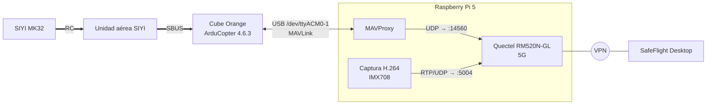
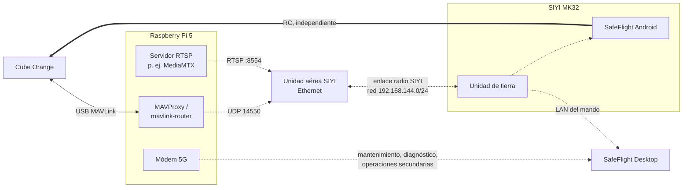

# Arquitectura de comunicaciones

## 1. Conceptos que no deben confundirse

| Canal | Qué transporta | Quién lo gestiona | Relación con SafeFlight |
|---|---|---|---|
| **RC** (radiocontrol) | Canales de mando del piloto (SBUS/PPM) hacia el autopiloto | Mando SIYI MK32 → unidad aérea SIYI → Cube Orange | Ninguna. SafeFlight no lo genera ni lo modifica. |
| **MAVLink** | Protocolo de mensajes entre autopiloto y estaciones | ArduPilot, MAVProxy | SafeFlight lo recibe (telemetría). |
| **Telemetría** | Subconjunto de MAVLink con el estado del vehículo | — | Se muestra; ver [contrato](../../shared/protocols/mavlink-telemetry-contract.md). |
| **Vídeo** | H.264 de la cámara IMX708 | Raspberry Pi | Canal independiente de MAVLink. |
| **Red IP** | Medio para MAVLink/UDP y vídeo | 5G + VPN, o red SIYI | Configurada por perfiles. |
| **Mantenimiento** | SSH, actualizaciones, diagnóstico | 5G + VPN | Fuera de SafeFlight. |

El RC y MAVLink son sistemas distintos: perder MAVLink no implica perder el RC, y
viceversa. SafeFlight no implementa conmutación automática entre enlaces.

## 2. Arquitectura actual (5G / VPN)

| Enlace | Tipo | Estado |
|---|---|---|
| Cube ↔ Raspberry por USB | Físico + MAVLink | VERIFICADO en pruebas previas del proyecto (detección del Cube) |
| MAVProxy → Desktop por UDP 14560 | Lógico | Funcionamiento previo del proyecto; no re-verificado en este trabajo |
| Vídeo H.264 Raspberry → PC | Lógico (RTP/UDP) | Transmisión conseguida previamente; no re-verificada aquí |
| Conectividad 5G/SSH | Físico | Incidencias abiertas (fuera de alcance) |
| MK32 → Cube (RC) | Físico | Armado con el mando y respuesta de motores sin hélices; **no** es validación de vuelo |
| Armado desde Desktop | Lógico | NO PROBADO (ni en vuelo ni en SITL) |

En SafeFlight este escenario corresponde al perfil **5G / VPN** (`udpin:0.0.0.0:14560`,
RTP/UDP 5004), que reproduce la configuración fija de v0.2.

## 3. Arquitectura objetivo (enlace SIYI principal, 5G secundario)

| Enlace | Estado |
|---|---|
| Raspberry ↔ unidad aérea SIYI (Ethernet) | PENDIENTE DE HARDWARE |
| MAVLink por el enlace SIYI hasta el MK32 | PENDIENTE DE HARDWARE |
| RTSP desde la Raspberry por el enlace SIYI | DISEÑADO (no existe aún servidor RTSP en la Raspberry) |
| SafeFlight Android recibiendo MAVLink UDP | VERIFICADO en emulador con datos sintéticos |
| SafeFlight Android reproduciendo RTSP | VERIFICADO en emulador con servidor independiente |
| 5G como vía secundaria | Se conserva sin cambios |

Datos de red **no verificados oficialmente** (referencias de foros y documentación de
productos SIYI relacionados): unidad de tierra 192.168.144.12, cámaras SIYI en
192.168.144.25, puerto UDP de telemetría 19856 en algunos firmwares. El perfil SIYI
LOCAL usa valores provisionales y se debe ajustar tras medir la red real
([deployment/mk32.md](../deployment/mk32.md)).

## 4. Puertos por defecto

| Uso | Desktop | Android | Configurable |
|---|---|---|---|
| MAVLink UDP (escucha) | 14560 | 14550 | Sí, por perfil |
| Vídeo RTP/UDP | 5004 (+5005 RTCP) | — | Sí |
| RTSP | `rtsp://192.168.144.30:8554/raspicam` (provisional) | idem | Sí |
| Servidor RTSP de pruebas | `127.0.0.1:18554` | `10.0.2.2:18554` (emulador) | — |

El puerto 18554 del servidor de pruebas evita el 8554, que el emulador de Android
ocupa en `127.0.0.1` para su servicio gRPC.

## 5. Cambios en la Raspberry

Ninguno. Este trabajo no ha modificado `5g.service`, scripts 5G, NetworkManager, VPN,
configuración USB del Cube, servicios de misión o vídeo ni el módem. Para la
arquitectura objetivo será necesario, en un trabajo posterior y con el procedimiento
de cambios controlados (estado original, copia, riesgos, validación, reversión):

1. Configurar una IP estática de la Raspberry en la red SIYI.
2. Añadir una salida MAVLink de MAVProxy hacia el MK32 (sin retirar la salida 5G).
3. Publicar la cámara mediante RTSP.
