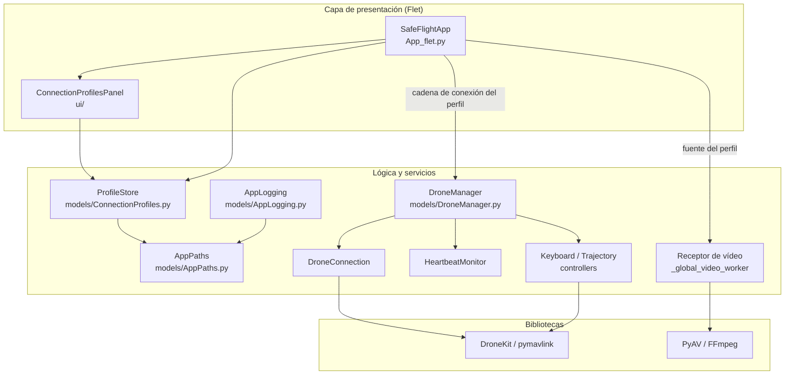

# Arquitectura de SafeFlight Desktop

## 1. Resumen

| Aspecto | Decisión |
|---|---|
| Lenguaje | Python 3.12 (mínimo 3.11 por `numpy 2.4`) |
| Interfaz | Flet 0.82 (Flutter) con `flet-map` y `flet-charts` |
| Punto de entrada | `App_flet.py` → `ft.run(main)`; `--self-check` para verificación sin interfaz |
| MAVLink | DroneKit 2.9.2 sobre pymavlink 2.4.49 |
| Vídeo | PyAV 19 (FFmpeg incluido): RTP/UDP con SDP local o RTSP |
| Configuración | Perfiles JSON en el directorio de usuario del SO |
| Empaquetado | PyInstaller 6.22, modo *one-folder* (`.app` en macOS) |
| Interfaces heredadas | `App_tkinter.py`, `main.py`, `main_production.py` (no empaquetadas, sin cambios) |

## 2. Componentes

| Componente | Responsabilidad | Hilo |
|---|---|---|
| `SafeFlightApp` | Construcción de la UI, bucles de refresco (`asyncio` de Flet) | principal / tareas Flet |
| `ProfileStore` | Cargar, validar, migrar y guardar perfiles de forma atómica | principal |
| `ConnectionProfilesPanel` | Editor modal de perfiles | principal |
| `DroneManager` | Conexión DroneKit, despegue, selección de controlador | `connection-worker`, `takeoff-sequence` |
| `HeartbeatMonitor` | Ordena `LAND` tras 15 s sin heartbeat (comportamiento previo) | propio |
| `_global_video_worker` | Decodifica vídeo con PyAV y publica el último fotograma | propio, global al proceso |
| `AppLogging` | Duplica stdout/stderr a un log por sesión | — |

## 3. Flujo de datos

1. Al arrancar, `ProfileStore.load()` lee `connection_profiles.json`; si no existe,
   crea los perfiles de fábrica migrando `video_settings.json` y las variables
   `SIM_conn_str`/`REAL_conn_str` del `.env` (comportamiento anterior conservado).
2. La fuente de vídeo del perfil activo se publica con `_set_global_video_source()`.
   El receptor detecta el cambio de «generación» y reabre la fuente sin reiniciar
   la aplicación.
3. **CONNECT** usa `profile.mavlink_connection_string()` (p. ej. `udpin:0.0.0.0:14560`)
   y los tiempos de espera del perfil. Mientras hay sesión MAVLink, el selector de
   perfil queda bloqueado: cambiar de endpoint exige reiniciar la aplicación.
4. El bucle de UI muestra modo, armado, posición, altitud y, nuevo, la **edad del
   último heartbeat** con el umbral `telemetry_stale_s`.

## 4. Configuración y persistencia

| Sistema | Configuración | Logs |
|---|---|---|
| Windows | `%APPDATA%\SafeFlightDesktop\` (misma ruta que v0.2) | `%LOCALAPPDATA%\SafeFlightDesktop\logs\` |
| macOS | `~/Library/Application Support/SafeFlightDesktop/` | `~/Library/Logs/SafeFlightDesktop/` |
| Linux | `$XDG_CONFIG_HOME/SafeFlightDesktop/` (`~/.config`) | `$XDG_STATE_HOME/SafeFlightDesktop/logs/` |

* Escritura atómica (`.tmp` + `fsync` + `os.replace`).
* Fichero corrupto o de versión futura: se conserva como `*.corrupt-<fecha>` y se
  restauran los valores de fábrica; la aplicación arranca igualmente.
* Perfiles inválidos se ignoran con aviso; los de fábrica eliminados del fichero se restauran.
* Las contraseñas de URL RTSP se ocultan en logs e interfaz (`redact_url`).
* `SAFEFLIGHT_CONFIG_DIR` y `SAFEFLIGHT_LOG_DIR` permiten aislar pruebas.

## 5. Vídeo

| Modo | Fuente | Implementación |
|---|---|---|
| `rtp_udp` | RTP H.264 (PT 96) en un puerto UDP local | SDP generado en el directorio de usuario (`write_runtime_sdp`) y abierto con PyAV |
| `rtsp` | Servidor RTSP (p. ej. MediaMTX en la Raspberry) | PyAV con `rtsp_transport` tcp/udp del perfil |
| `none` | — | receptor inactivo |

RTSP y RTP no son equivalentes: RTSP es un protocolo de control de sesión que
negocia el transporte (RTP sobre TCP intercalado o sobre UDP); `rtp_udp` recibe
directamente un flujo RTP ya enviado por el emisor, sin negociación. Por eso se
configuran por separado ([ADR-0006](../adr/ADR-0006-video-telemetry-separation.md)).

## 6. Compatibilidad entre plataformas

| Aspecto | Hallazgo | Tratamiento |
|---|---|---|
| Directorio de configuración | Usaba `%APPDATA%` y, fuera de Windows, `~/SafeFlightDesktop` | `AppPaths` por SO; la ruta antigua se lee para migrar |
| Especificación PyInstaller | Ruta absoluta de Windows en `version=` | Nueva especificación `packaging/desktop/SafeFlightDesktop.spec` |
| Dependencia `av` | Usada pero ausente de `requirements.txt` | Añadida y fijada |
| Consola | Windows mostraba consola de diagnóstico | Se mantiene en Windows; en macOS `.app` sin consola, con log a fichero |
| Cliente Flet | `flet_desktop` contiene el cliente nativo por SO | Incluido con `collect_all("flet_desktop")` |
| `cwd/build/<so>` | Flet busca allí un cliente propio antes que el empaquetado | Salidas de `build.py` en `build/pyinstaller/` y `dist/` |
| Red local en macOS 15 | Requiere declarar el acceso a la red local | `NSLocalNetworkUsageDescription` en `Info.plist` |
| `keyboard` | Requiere privilegios en macOS/Linux | No lo importa `App_flet.py`; solo los scripts CLI heredados |
| Arquitecturas | Wheels nativos (numpy, av, cv2) por arquitectura | Paquetes macOS separados arm64 y x64; sin *universal2* |

## 7. Gestión de errores y diagnóstico

* `--self-check`: comprueba recursos, decodificador H.264, OpenCV, Flet y el ciclo de
  persistencia; devuelve JSON y código de salida. `build.py` y CI lo ejecutan sobre el
  **ejecutable empaquetado**.
* Panel lateral: estado MAVLink con edad de heartbeat, fuente de vídeo y ruta del log.
* El cierre de la interfaz detiene el `HeartbeatMonitor` (`health.stop()`). Antes se
  invocaba `_stop_event()` como función, lo que lanzaba una excepción y dejaba el
  monitor activo; el comentario existente ya indicaba que cerrar la interfaz no debe
  enviar comandos.

## 8. Limitaciones conocidas

* La interfaz se ha validado de extremo a extremo solo en Windows (ejecutable empaquetado,
  [ADR-0009](../adr/ADR-0009-gui-validation-method.md)); en Linux se ha verificado la
  compilación y el arranque gráfico, no la interacción; macOS está pendiente.
* `TAKEOFF`/`LAND` de Desktop son funciones previas no probadas (ni SITL ni vuelo físico).
* Cambiar el endpoint MAVLink de una sesión abierta requiere reiniciar la aplicación
  (DroneKit no permite reconectar el mismo `Vehicle` de forma fiable); la fuente de vídeo
  sí cambia en caliente.
* Los botones de solo icono tienen una etiqueta de accesibilidad incorrecta (defecto
  preexistente de `ft.Button` sin `content` en Flet 0.82); se dibujan y funcionan.
* Linux requiere bibliotecas del sistema para el cliente Flet: `libgtk-3-0`, `libmpv2`,
  `libsecret-1-0`, `libgstreamer1.0-0`, `libgstreamer-plugins-base1.0-0`, `libgles2`, `libegl1`.
* macOS mínimo 14.0 por las dependencias nativas.
