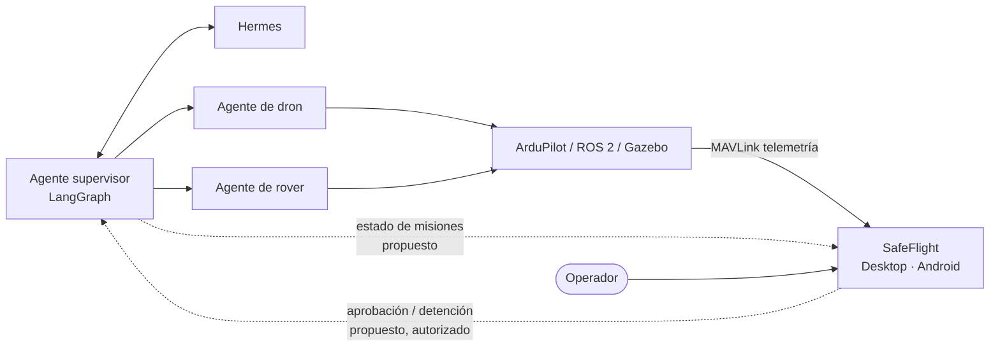

# Puntos de integración con el sistema multiagente del TFG

**Estado global: DISEÑADO.** Ninguna de las interfaces de este documento está
implementada. Son propuestas para integrar SafeFlight con el agente supervisor,
los agentes de dron y rover, Hermes y LangGraph sin trasladar inteligencia
multiagente a las estaciones de control.

## 1. Papel de SafeFlight en el sistema



SafeFlight es **cliente**: consulta estado y presenta información. La planificación,
la coordinación y la ejecución pertenecen al sistema multiagente y al autopiloto.

## 2. Interfaces propuestas

| # | Interfaz | Dirección | Propuesta | Estado |
|---|---|---|---|---|
| I-1 | Estado de misiones | Supervisor → SafeFlight | WebSocket o SSE con eventos JSON; alternativa: consulta REST periódica | DISEÑADO |
| I-2 | Telemetría | Vehículo → SafeFlight | MAVLink actual (sin cambios) | IMPLEMENTADO |
| I-3 | Simulación / físico | Supervisor → SafeFlight | Campo `execution_mode` en cada misión | IMPLEMENTADO en el modelo Android; integración DISEÑADA |
| I-4 | Resultados y errores | Supervisor → SafeFlight | Campos `result` y `error` por misión | IMPLEMENTADO en el modelo Android (demo) |
| I-5 | Aprobación de misión | SafeFlight → Supervisor | Petición autenticada con confirmación del operador | DISEÑADO, deshabilitado |
| I-6 | Detención autorizada | SafeFlight → Supervisor | Igual que I-5; la detención física la ejecuta el autopiloto | DISEÑADO, deshabilitado |

### Evento de misión propuesto (I-1)

```json
{
  "mission_id": "M-2026-0001",
  "title": "Inspección perímetro norte",
  "vehicles": ["drone-1"],
  "status": "PENDING | APPROVED | RUNNING | COMPLETED | FAILED | CANCELLED",
  "execution_mode": "SIMULATED | PHYSICAL",
  "summary": "texto para el operador",
  "result": null,
  "error": null,
  "updated_at": "2026-11-19T16:00:00Z",
  "source": "supervisor"
}
```

El modelo `Mission` de Android ([`mission/Missions.kt`](../../android/app/src/main/java/org/safeflight/android/mission/Missions.kt))
ya refleja estos campos. Sustituir `DemoMissionRepository` por un cliente del supervisor
no requiere cambiar las pantallas: ambos implementan `MissionRepository`.

## 3. Requisitos antes de habilitar I-5 / I-6

* Autenticación y autorización del operador.
* Confirmación explícita y registro de auditoría.
* Comprobación del estado del vehículo y del enlace (ya expuesto por `CommandGate`).
* Tiempo de espera y ACK de extremo a extremo; distinción entre aceptación y finalización.
* Prevención de órdenes duplicadas.
* Pruebas en SITL y análisis de seguridad.

## 4. Distinción simulación / físico

Toda misión debe declarar `execution_mode`. La interfaz Android ya diferencia
visualmente «SIMULACIÓN» y «FÍSICA» (esta última en rojo). Se propone que el
supervisor rechace cualquier misión física si SafeFlight no confirma enlace de
telemetría vigente con el vehículo correspondiente.
