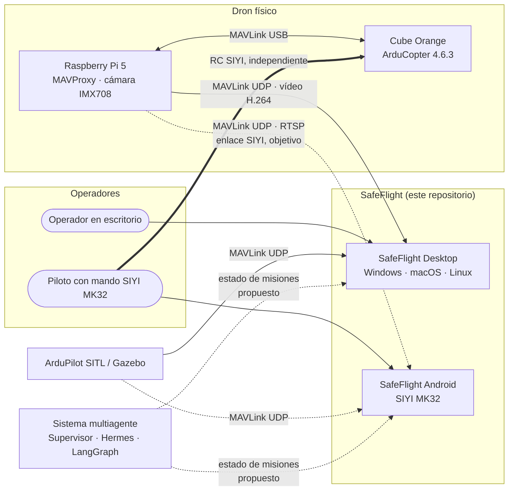

# Arquitectura global de SafeFlight

Este documento describe la arquitectura de SafeFlight, el conjunto de estaciones de
control del TFG, y sirve de índice para el resto de documentos de arquitectura.

| Documento | Contenido |
|---|---|
| [desktop.md](desktop.md) | Arquitectura de SafeFlight Desktop |
| [android.md](android.md) | Arquitectura de SafeFlight Android (GCS para SIYI MK32) |
| [communications.md](communications.md) | Enlaces físicos y lógicos: actuales y objetivo |
| [build-and-deployment.md](build-and-deployment.md) | Compilación, CI y despliegue |
| [integration-points.md](integration-points.md) | Interfaces previstas con el sistema multiagente |
| [../adr/](../adr/) | Registro de decisiones arquitectónicas (ADR) |
| [../evaluation/validation-matrix.md](../evaluation/validation-matrix.md) | Matriz de validación y evidencias |

## 1. Leyenda de estados

Todos los documentos usan esta clasificación. Nada se marca como verificado sin una
prueba reproducible registrada en [../evaluation/test-log.md](../evaluation/test-log.md).

| Estado | Significado |
|---|---|
| **IMPLEMENTADO** | Existe en código. |
| **VERIFICADO** | Existe en código y hay pruebas reproducibles que lo acreditan. |
| **PARCIAL** | Implementación incompleta o verificada solo en parte. |
| **DISEÑADO** | Especificado, sin implementar. |
| **PENDIENTE DE HARDWARE** | Requiere dispositivos físicos no disponibles durante la prueba. |
| **NO PROBADO** | No ejecutado o sin evidencias suficientes. |

## 2. Contexto del sistema

SafeFlight es la capa de **supervisión humana** del sistema: muestra vídeo y
telemetría de los vehículos y, en el futuro, el estado de las misiones planificadas
por el sistema multiagente. No sustituye al radiocontrol ni al autopiloto.



*Línea continua: implementado. Línea discontinua: objetivo o propuesto. Línea doble:
radiocontrol, fuera del alcance de SafeFlight.*

## 3. Principios de diseño

1. **Supervisión antes que control.** Las aplicaciones reciben y muestran información;
   los comandos de vuelo de Android están bloqueados por diseño
   ([ADR-0008](../adr/ADR-0008-flight-commands-disabled.md)).
2. **Configuración separada del código.** IP, puertos y fuentes de vídeo viven en
   perfiles editables ([ADR-0005](../adr/ADR-0005-connection-profiles.md)).
3. **Aplicaciones independientes, contratos compartidos.** Desktop (Python) y
   Android (Kotlin) comparten esquemas, contrato MAVLink y vectores de prueba,
   no código ([ADR-0001](../adr/ADR-0001-monorepo-structure.md)).
4. **Vídeo y telemetría separados.** Dos canales con diagnóstico independiente
   ([ADR-0006](../adr/ADR-0006-video-telemetry-separation.md)).
5. **Valores desconocidos explícitos.** Un dato no recibido se muestra como «—»;
   un dato antiguo se marca como obsoleto.

## 4. Organización del repositorio

```text
SafeFlightDesktop/
├── App_flet.py, models/, ui/, assets/   SafeFlight Desktop (sin mover, ver ADR-0001)
├── android/                             SafeFlight Android (proyecto Gradle independiente)
├── shared/                              contratos: esquemas, protocolo, vectores, ejemplos
├── packaging/desktop/                   especificación PyInstaller multiplataforma
├── scripts/                             generadores de prueba (MAVLink, RTP, servidor RTSP)
├── tests/desktop/                       pruebas de Desktop (pytest)
├── docs/                                arquitectura, ADR, desarrollo, despliegue, evaluación
├── .github/workflows/                   CI Desktop (4 plataformas), Android y release
├── build.py                             punto único de compilación
└── VERSION                              versión común de ambas aplicaciones
```

## 5. Matriz de componentes

| Componente | Ubicación | Responsabilidad | Estado |
|---|---|---|---|
| Interfaz Desktop | `App_flet.py` | UI Flet: mapa, HUD, vídeo, trayectorias | IMPLEMENTADO (previo) |
| Gestión de vuelo Desktop | `models/DroneManager.py`, controladores | Conexión DroneKit, despegue, trayectorias | Conexión VERIFICADA desde la interfaz con datos sintéticos; despegue/aterrizaje NO PROBADO (ni SITL ni vuelo) |
| Perfiles de conexión Desktop | `models/ConnectionProfiles.py`, `ui/ConnectionProfilesPanel.py` | Persistencia, validación, migración, edición | VERIFICADO (lógica e interfaz del ejecutable Windows) |
| Rutas multiplataforma | `models/AppPaths.py` | Directorios de configuración, logs y recursos por SO | VERIFICADO |
| Registro de sesión | `models/AppLogging.py` | Log a fichero en todas las plataformas | VERIFICADO (Windows y Linux) |
| Receptor de vídeo Desktop | `App_flet._global_video_worker` | PyAV RTP/SDP y RTSP, cambio en caliente | VERIFICADO (integración y dentro de la ventana, Windows) |
| Cliente MAVLink Android | `android/.../mavlink/` | Analizador v1/v2, UDP, supervisión de enlace | VERIFICADO (unitarias + emulador) |
| Vídeo Android | `android/.../video/` | Media3 RTSP, *watchdog*, reintentos | VERIFICADO (emulador) |
| Perfiles Android | `android/.../config/` | Mismo esquema JSON que Desktop | VERIFICADO (unitarias y edición desde la interfaz en emulador) |
| Misiones Android | `android/.../mission/` | Interfaz de repositorio + datos de demostración | IMPLEMENTADO (demo); integración DISEÑADA |
| Puerta de comandos | `android/.../control/CommandGate.kt` | Bloqueo de comandos físicos | VERIFICADO (bloqueo) |
| Sistema de compilación | `build.py`, `.github/workflows/` | Build, pruebas, empaquetado, CI | VERIFICADO (Windows, Linux en contenedor, Android local); macOS y CI NO PROBADO hasta el primer *push* |
| Integración multiagente | — | Recepción de estado de misiones | DISEÑADO ([integration-points.md](integration-points.md)) |
| Enlace SIYI de datos | — | MAVLink/RTSP sobre SIYI | PENDIENTE DE HARDWARE |
